# ERP Core — Phase 1 (Backend)

The multi-tenant core that the Retail, Pharmacy, Hardware and School verticals will sit on. This
repository contains the backend only.

- Next.js 14 (App Router), TypeScript in strict mode
- Supabase (Postgres and Auth) with plain SQL migrations
- Vitest, running against a real local Postgres
- `pg` (node-postgres) for data access
- Money is `NUMERIC(19,4)` in Postgres and a `decimal.js` decimal in TypeScript

Prisma is deliberately not used. The schema lives in plain SQL migrations under
`supabase/migrations/`, because triggers, partitions, RLS and functions do not map onto Prisma
migrations, and Prisma usually connects as a role that bypasses RLS.

## Contents

- [Getting started](#getting-started)
- [Data model](#data-model)
- [Tenancy and RLS](#tenancy-and-rls)
- [Indexing strategy](#indexing-strategy)
- [Partitioning](#partitioning)
- [Accounting engine](#accounting-engine)
- [Inventory](#inventory)
- [Sales and purchases](#sales-and-purchases)
- [Retail extension (R1)](#retail-extension-r1)
- [Retail extension (R2)](#retail-extension-r2)
- [Retail extension (R3)](#retail-extension-r3)
- [Retail extension (R4)](#retail-extension-r4)
- [Retail extension (R5)](#retail-extension-r5)
- [Retail extension (R6)](#retail-extension-r6)
- [Branch server (H1)](#branch-server-h1)
- [Offline sync engine (H2)](#offline-sync-engine-h2)
- [Adding a vertical module](#adding-a-vertical-module)
- [Tests, checks and the perf run](#tests-checks-and-the-perf-run)

## Getting started

Docker must be running.

```bash
supabase start        # local Postgres and Auth
supabase db reset     # apply every migration to an empty database
cp .env.example .env.local   # if you do not have one yet
npm install
npm test              # the 40 tests, against the real local database
npm run build
```

`supabase status` prints the connection URLs. `DATABASE_URL` and `TEST_DATABASE_URL` both point at
the local database; no hosted Supabase project, Upstash or Redis is needed in this phase.

Business logic lives in SQL functions under the `app` schema. TypeScript route handlers in
`src/app/api/**` stay thin: they parse the request, call one function inside a user-scoped
transaction, and serialise the result. The domain modules in `src/core` and `src/accounting` are
typed wrappers over those functions.

## Data model

```mermaid
erDiagram
    organizations ||--o{ branches : has
    organizations ||--o{ memberships : has
    organizations ||--o{ invites : has
    organizations ||--|| settings : has
    organizations ||--o{ number_series : has
    organizations ||--o{ chart_of_accounts : has
    organizations ||--o{ fiscal_periods : has
    organizations ||--o{ tax_rates : has
    organizations ||--o{ exchange_rates : has
    organizations ||--o{ products : has
    organizations ||--o{ product_variants : has
    organizations ||--o{ contacts : has

    branches ||--o{ warehouses : has
    branches ||--o{ journals : has
    branches ||--o{ stock_ledger : has
    branches ||--o{ sales_orders : has
    branches ||--o{ invoices : has
    branches ||--o{ payments : has
    branches ||--o{ credit_notes : has
    branches ||--o{ purchase_orders : has
    branches ||--o{ stock_transfers : has
    branches ||--o{ audit_logs : has

    products ||--o{ product_variants : has
    warehouses ||--o{ stock_ledger : holds
    warehouses ||--o{ stock_balances : caches
    products ||--o{ stock_ledger : moves
    products ||--o{ stock_balances : caches

    stock_ledger ||--o{ stock_consumptions : consumed_by
    stock_ledger ||--|| stock_layer_balances : remaining
    warehouses ||--o{ stock_layer_balances : holds

    journals ||--|{ journal_lines : contains
    chart_of_accounts ||--o{ journal_lines : posts_to
    journals ||--o| journals : reverses

    invoices ||--|{ invoice_lines : contains
    invoices ||--o{ payments : settled_by
    invoices ||--o{ credit_notes : credited_by
    invoices ||--o{ manual_discounts : discounted_by
    contacts ||--o{ invoices : billed_to
    contacts ||--o{ purchase_orders : ordered_from
    contacts }o--o| customer_groups : belongs_to
    journals ||--o| invoices : posts_for

    organizations ||--o{ price_lists : has
    price_lists ||--o{ price_list_items : lists
    product_variants ||--o{ price_list_items : priced_by
    organizations ||--o{ customer_groups : has
    customer_groups }o--o| price_lists : prices_at
    organizations ||--o{ promotions : has
    organizations ||--o{ discount_limits : caps

    organizations ||--o{ credit_limits : caps
    contacts ||--o| credit_limits : limited_by
    branches ||--o{ laybys : has
    contacts ||--o{ laybys : places
    laybys ||--|{ layby_reservations : reserves
    laybys ||--o| invoices : collected_as
    branches ||--o{ returns : has
    invoices ||--o{ returns : returned_from
    returns ||--|{ return_lines : contains
    return_lines }o--|| invoice_lines : returns
    branches ||--o{ z_reports : summarises
    shifts ||--o| z_reports : closed_as
    branches ||--o{ stock_counts : has
    stock_counts ||--|{ stock_count_items : counts

    organizations {
        uuid id PK
        uuid org_id
        text name
        text slug
        text base_currency
        timestamptz created_at
    }
    branches {
        uuid id PK
        uuid org_id FK
        text name
        text slug
        timestamptz created_at
    }
    memberships {
        uuid id PK
        uuid org_id FK
        uuid user_id FK
        text role
        uuid[] branch_ids
        timestamptz created_at
    }
    journals {
        uuid id PK
        timestamptz created_at PK
        uuid org_id FK
        uuid branch_id FK
        date posting_date
        text source_type
        uuid reversal_of FK
    }
    journal_lines {
        uuid id PK
        timestamptz created_at PK
        uuid journal_id FK
        timestamptz journal_created_at FK
        uuid account_id FK
        numeric debit
        numeric credit
        numeric exchange_rate
        numeric base_debit
        numeric base_credit
    }
    stock_ledger {
        uuid id PK
        timestamptz created_at PK
        uuid warehouse_id FK
        uuid product_id FK
        text direction
        numeric qty
        numeric unit_cost
    }
    stock_consumptions {
        uuid id PK
        timestamptz created_at PK
        uuid out_ledger_id FK
        uuid in_ledger_id FK
        numeric qty
    }
    invoices {
        uuid id PK
        uuid branch_id FK
        text invoice_no
        numeric total
        uuid journal_id FK
    }
    audit_logs {
        uuid id PK
        timestamptz created_at PK
        text table_name
        uuid record_id
        text action
    }
    laybys {
        uuid id PK
        uuid org_id FK
        uuid branch_id FK
        uuid contact_id FK
        text layby_no
        text status
        date due_date
        numeric total
        numeric deposit_paid
        numeric cancellation_fee
    }
    layby_reservations {
        uuid id PK
        uuid org_id FK
        uuid branch_id FK
        uuid layby_id FK
        uuid product_id FK
        numeric qty
        numeric unit_cost
        text status
    }
    returns {
        uuid id PK
        uuid org_id FK
        uuid branch_id FK
        uuid original_invoice_id FK
        text return_no
        text refund_method
        numeric total
    }
    z_reports {
        uuid id PK
        uuid org_id FK
        uuid branch_id FK
        uuid shift_id FK
        text z_no
        numeric gross_sales
        numeric tax_total
        jsonb vat_by_rate
    }
    stock_counts {
        uuid id PK
        timestamptz created_at PK
        uuid org_id FK
        uuid branch_id FK
        uuid warehouse_id FK
        text count_no
        text status
    }
    fiscal_device_integration {
        uuid id PK
        uuid org_id FK
        uuid branch_id FK
        text device_type
        text mode
        text status
        timestamptz last_sync
        jsonb payload
        timestamptz created_at
    }
    fiscal_jobs {
        uuid id PK
        uuid org_id FK
        uuid branch_id FK
        uuid sale_id FK
        uuid invoice_id FK
        text status
        jsonb payload
        timestamptz created_at
    }
    fiscal_job_attempts {
        uuid id PK
        uuid org_id FK
        uuid branch_id FK
        uuid job_id FK
        int attempt_no
        text outcome
        text error
        timestamptz attempted_at
        timestamptz created_at
    }
    branches ||--o| fiscal_device_integration : configures
    branches ||--o{ fiscal_jobs : queues
    fiscal_jobs ||--o{ fiscal_job_attempts : attempts
```



## Tenancy and RLS

Every tenant table has `org_id uuid NOT NULL` and `created_at timestamptz NOT NULL DEFAULT now()`.

- Org-scoped tables: `organizations` (its `id` is the `org_id`), `branches`, `memberships`,
  `invites`, `settings`, `number_series`, `products`, `product_variants`, `contacts`,
  `chart_of_accounts`, `tax_rates`, `exchange_rates`, `fiscal_periods`.
- Branch-scoped tables, which also carry `branch_id`: `warehouses`, `stock_ledger`,
  `stock_consumptions`, `stock_balances`, `stock_layer_balances`, `stock_transfers`, `journals`,
  `journal_lines`, `sales_orders`, `invoices`, `invoice_lines`, `payments`, `credit_notes`,
  `purchase_orders`, `audit_logs`.

RLS is enabled and forced on every tenant table. Policies read the JWT through `auth.jwt()`:

- Org-scoped policies compare `org_id` with `auth.jwt() ->> 'org_id'` (the key must be quoted).
- Branch-scoped policies also check `branch_id` against `auth.jwt() -> 'branch_ids'`.

A Supabase custom access token hook (`app.custom_access_token_hook`) adds `org_id` and
`branch_ids` to the token when it is minted.

> **Membership changes take effect when the token refreshes.** Policies read the claims baked into
> the current access token, never the `memberships` table. Adding or removing a membership does not
> change what an already-issued token can see. The user must refresh the token (sign in again, or
> wait for the refresh) before the change applies. Test 6 asserts exactly this.

Invites store only a SHA-256 hash of the token. A token is single use and expires after 72 hours.
The plaintext token is returned once, to the caller that created the invite, and never stored.

Application request paths run as the caller. `withUserContext` opens a transaction, runs
`SET LOCAL ROLE authenticated`, and sets `request.jwt.claims`, so RLS is genuinely enforced. The
service role key is never used on a request path.

Tests act as a user the same way: inside a transaction they set the role and the claims. No test
runs as the `postgres` superuser for an RLS assertion.

## Indexing strategy

- Branch-scoped high-volume tables get `(org_id, branch_id, created_at DESC, id DESC)`. That index
  serves both the RLS predicate and keyset pagination on `(created_at, id)`.
- Org-scoped tables get `(org_id, created_at DESC, id DESC)`.
- Business keys get composite uniques: `UNIQUE(org_id, slug)` on `branches`, `UNIQUE(org_id, sku)`
  on `products`, `UNIQUE(org_id, code)` on `chart_of_accounts`, and so on.
- Every foreign key column gets an index.

Two scripts prove the invariants hold:

```bash
psql "$DATABASE_URL" -f scripts/check-fk-indexes.sql      # zero rows
psql "$DATABASE_URL" -f scripts/check-tenant-tables.sql   # zero rows
```

`check-fk-indexes.sql` returns one row per foreign key with no index whose leading columns match
the FK columns in order. `check-tenant-tables.sql` returns one row per tenant table missing
`org_id`, `created_at`, or RLS enabled and forced.

## Partitioning

`journals`, `journal_lines`, `stock_ledger`, `stock_consumptions` and `audit_logs` are
RANGE-partitioned monthly on `created_at`.

- Primary keys include `created_at`, for example `(id, created_at)`.
- Child rows carry the parent's partition key (`journal_created_at`, `out_ledger_created_at`,
  `in_ledger_created_at`) so the composite foreign key works.
- Migrations create partitions for the current month and the next two.
- There are no default partitions.

`app.ensure_partitions(months_ahead)` creates any missing partition for the current month plus
`months_ahead` months. Run it ahead of time, for example from a scheduled job:

```sql
select app.ensure_partitions(2);
```

It is safe to run repeatedly: it only creates partitions that do not exist yet.

## Accounting engine

Tables: `chart_of_accounts`, `fiscal_periods`, `tax_rates`, `exchange_rates`, `journals`,
`journal_lines`.

Each journal line stores `debit`, `credit`, `currency`, `exchange_rate`, `base_debit` and
`base_credit`. A line has either a debit or a credit, never both, and never a negative value.

- **Balance check.** A `DEFERRABLE INITIALLY DEFERRED` constraint trigger on `journal_lines`
  verifies at commit that each journal has at least two lines and that `sum(base_debit)` equals
  `sum(base_credit)`. See `docs/ADR.md` (ADR-0001) for why the trigger sits on the partitioned
  parent.
- **Rounding.** Base amounts are rounded to four decimal places per line. Any residual difference
  posts to the rounding account named in `settings`, never dropped silently.
- **Immutability.** Triggers reject `UPDATE` and `DELETE` on `journals`, `journal_lines`,
  `stock_ledger`, `stock_consumptions` and `audit_logs`, and the privileges are revoked from
  `authenticated`. A correction is a reversing journal whose `reversal_of` points at the original.
- **Closed periods.** A journal dated inside a closed `fiscal_periods` row is rejected.
- **Rates.** Exchange rates and VAT rates are effective-dated. Each journal line and each invoice
  line stores the rate it used, so a later rate change never rewrites history. Posting reads rates
  from the database inside its own transaction.
- **Reports.** Trial balance, P&L and balance sheet query `journal_lines` directly with indexed
  date-range predicates. There are no materialized views or summary tables in this phase.

`app.post_journal` is the single posting entry point, and `app.reverse_journal` posts the mirror
image of an existing journal.

## Inventory

Tables: `products`, `product_variants`, `warehouses`, `stock_ledger` (append-only movements),
`stock_consumptions` (which inbound layer each outbound movement consumed, and how much),
`stock_balances` (a mutable cache of on-hand quantity and value) and `stock_layer_balances` (a
mutable cache of remaining quantity per inbound layer).

- **FIFO.** `app.consume_fifo` consumes the oldest layer first and records every consumption as a
  new `stock_consumptions` row. A layer row is only ever decremented, never rewritten.
- **Lock order.** `app.lock_stock_balances` locks `stock_balances` rows one key at a time in
  ascending `(warehouse_id, product_id, variant_id)` order, which is what keeps concurrent
  transactions from deadlocking.
- **Negative stock** is rejected by default. `warehouses.allow_negative_stock` opts a warehouse in.
- `stock_balances` and `stock_layer_balances` are the only mutable caches, and both can be rebuilt
  from the immutable `stock_ledger`.

## Sales and purchases

- `app.post_receipt` — inbound stock layer plus journal (Dr Inventory, Cr Accounts Payable).
- `app.create_invoice` — takes a gapless number, locks stock in sorted order, checks availability,
  consumes FIFO layers, inserts the invoice and its lines, and posts the journal (Dr AR, Cr Revenue,
  Cr VAT Output, Dr COGS, Cr Inventory). All or nothing.
- `app.allocate_payment` — applies a payment to an invoice. It cannot exceed the open balance, and
  posts Dr Bank, Cr AR.
- `app.create_credit_note` — reverses revenue, VAT and AR, returns stock at the original FIFO cost,
  and posts a reversing journal.
- `app.post_stock_adjustment` — as described under [Inventory](#inventory).

Invoice numbers are gapless. They come from a `number_series` row locked with `SELECT ... FOR
UPDATE` inside the invoice transaction, so a rollback does not consume a number. SKUs also come
from `number_series`, generated in SQL. Postgres sequences are not used for either.

List endpoints use keyset pagination on `(created_at, id)`. The default limit is 50 and the maximum
is 100; anything else is rejected. `OFFSET` is never used. Queries use explicit column lists, never
`SELECT *`, and batch child rows with `= ANY($1)`, so there are no N+1 queries.

A generic trigger writes `audit_logs` for `invoices`, `payments`, `journals`, `products` and
`stock_ledger` (receipts and adjustments). Nothing on a request path reads it.

## Retail extension (R1)

R1 is the first additive extension of the core. It adds the product, barcode and search surface a
till needs, without touching a core accounting path. See `docs/ADR.md` (ADR-0008, ADR-0009) and
`docs/CORE_INTERFACE.md`.

- **New tables.** `categories` (nested through `parent_id`, org-scoped) and `product_batches`
  (batch master: `batch_no`, `expiry_date`). Both use the standard RLS, index and check rules.
- **New columns.** `products` gains `category_id`, `unit` (the `product_unit` enum), `is_weighable`
  and a generated `name_search tsvector`. `product_variants` gains `size`, `color` and `barcode`.
  Every column is nullable or defaulted, so existing rows and core code are unaffected.
- **Barcodes** live on the variant and are unique within an org only when present, enforced by a
  partial unique index `product_variants (org_id, barcode) where barcode is not null`.
- **Weighable items** accept a decimal quantity (for example `0.750` kg); everything else accepts
  whole units only. `src/verticals/retail/quantity.ts` normalises a till quantity to `NUMERIC(19,4)`
  and rejects anything else.
- **Search.** `app.search_products(org_id, query, limit)` matches an exact barcode first, then a
  trigram name match, ordered by relevance and capped at 20 rows. It is backed by a single combined
  GIN index `products (org_id extensions.uuid_ops, name extensions.gin_trgm_ops)`, so the org
  predicate and the trigram predicate use one index. An empty query returns nothing: the till never
  loads the catalogue at startup.
- **Endpoint.** `GET /api/pos/search?q=` is a thin handler over `src/verticals/retail/products.ts`.
- **Client.** `src/verticals/retail/TillSearch.tsx` debounces input by 150 ms, so one request goes
  out after the cashier stops typing, and fetches nothing on mount.

To keep the name search an index scan, the SQL function is inlined: it carries no `set search_path`
clause (that clause blocks inlining) and its body is a parenthesised `UNION ALL` rather than a CTE
(a CTE is materialised, which hides the constant term from the planner). Every object is
schema-qualified, so inlining is safe.

## Retail extension (R2)

R2 adds pricing and promotions. It is additive: the only core-table change is a nullable
`contacts.group_id`, recorded in ADR-0011. See ADR-0011 to ADR-0013 and `docs/CORE_INTERFACE.md`.

- **Price lists.** `price_lists` (one `retail`, one `wholesale` per org) and `price_list_items`
  (unique per list and variant). A `customer_groups` row may point at a wholesale list.
- **Promotions.** `promotions` carries `type` (`bogo`, `percent`, `fixed`), a `valid_from` /
  `valid_to` window, a `priority`, a `stackable` flag and a `conditions` object
  (`variant_ids`, `min_qty`, `min_subtotal`, `value`).
- **Manual discounts.** `discount_limits` caps a discount per role (a role with no row has a limit
  of zero, so a manual discount is opt-in). `manual_discounts` records every discount with its
  reason.
- **Precedence**, enforced in one place (`app.get_price` / `app.get_prices`):
  1. the customer group's price list, falling back to the retail list per item;
  2. active promotions by priority, stacking only when both the primary and the follower are
     stackable;
  3. a manual discount for a role that is allowed one, with a reason.
- **Endpoints.** `POST /api/pos/price` resolves a whole cart in one round trip over
  `src/verticals/retail/pricing.ts`. A 30-item cart costs one batched query (plus one candidates
  read on a cold cache), never one query per item.
- **Redis.** Promotion *candidates* are cached under `promos:{org_id}` with a 300-second TTL, never
  a resolved price. Every evaluation re-checks the validity window in SQL, so a stale entry cannot
  apply an expired promotion; the cache is rebuildable and losing it costs one read. A write to
  `promotions` invalidates the key.

## Retail extension (R3)

R3 adds the online POS till. It is additive: it adds `shifts`, `pos_sales`, `pos_payments` and the
small `pos_sale_keys` claim table, and it adds no column to a core table. See ADR-0014.

- **A sale is a core invoice plus core payments, in one transaction.** `app.post_pos_sale` resolves
  each scan to a variant (by barcode or id), prices it through the R2 pricing functions when no
  price is given, calls `app.create_invoice` (gapless number, sorted stock locks, FIFO consumption,
  balanced journal), then calls `app.allocate_payment` once per tender, then writes `pos_sales` and
  `pos_payments`. The core balance check runs at commit. There is no async posting.
- **Tenders.** `pos_payments` holds one row per tender. A sale may take USD and ZWG together; each
  tender gets its own `pos_payments` row, its own core payment (Dr Bank, Cr AR), and the rate it
  used. Change is recorded in the currency that was given.
- **Idempotency.** `client_sale_id` makes a retried sale safe. The claim lives on the
  non-partitioned `pos_sale_keys` table with `unique (org_id, client_sale_id)`, because Postgres
  requires every unique constraint on a partitioned table to include the partition key (ADR-0014).
  A retry returns the original receipt and consumes no invoice number.
- **Shifts.** `shifts` is org and branch scoped, keyed by `till_id`, with `opened_at`, `closed_at`
  and `opening_float`. The index `(org_id, branch_id, till_id, opened_at desc)` finds the open
  shift for a till.
- **The till is keyboard only** at `/pos`. A scan is one action (barcode + Enter), F9 tenders exact
  cash, Enter confirms and prints. A one-item exact cash sale is three actions. The key script is in
  `docs/pos-keys.md`.
- **The cart is Zustand state**, never a server round trip, so scanning stays instant. Money is a
  decimal string end to end.
- **The receipt is 58mm, rendered in the browser** (`@page { width: 58mm }`), with no server call.
  It shows the lines, the VAT breakdown by rate, the tenders with change, and the core invoice
  number.
- **Endpoints.** `POST /api/pos/sales` rings a sale, `GET /api/pos/sales` lists a shift's sales with
  keyset pagination, `GET /api/pos/shifts` returns the till's context (open shift, default
  warehouse, VAT rate), `POST /api/pos/shifts` opens a shift. All thin, all through `src/verticals/pos`.

## Retail extension (R4)

R4 makes the till work offline. It is additive: it adds `pos_sync_exceptions` and re-creates two
core functions with a hook. See ADR-0015, ADR-0016, ADR-0017 and ADR-0018.

- **The outbox is IndexedDB** (`src/verticals/pos/outbox.ts`). A sale that cannot reach the server
  is written to the store before anything else, so it survives a reload or a crash. Each entry
  carries the `client_sale_id` generated at sale time, the `shift_id`, the till's local timestamp,
  the lines with the prices actually charged, the promotions that applied, and the tenders.
- **Sync delivers in batches.** `POST /api/pos/sync` accepts up to 50 sales and runs each in its own
  transaction on its own connection, under the caller's RLS context, so one bad sale cannot block
  the rest. The till's drain loop keeps one request in flight and removes an entry only when the
  server reports `committed` or `duplicate`. Retries use exponential backoff with full jitter.
- **Idempotency is the whole safety net.** The `client_sale_id` is the key on both paths. A duplicate
  returns the original receipt and posts nothing, which is what makes the retries safe.
- **A completed sale is never rejected.** A short-stock sale is retried once with the
  transaction-local allow-negative hook (`app.negative_stock_allowed()`, ADR-0015) and logged as
  `negative_stock`. A moved price or an expired promotion is honoured and logged as
  `price_variance` / `promotion_expired`. Only a malformed sale is reported as `exception`. Every
  exception is a row in `pos_sync_exceptions`.
- **The hook is transaction-local.** `set_config('app.allow_negative_stock', 'on', true)` is set
  only for the retry attempt, so it cannot leak to another request on a pooled connection, and the
  live sale path keeps the strict rule.
- **Live sales are rate limited, the backlog is not.** `POST /api/pos/sales` allows 30 sales per
  minute per cashier and returns `429` with `Retry-After` past that. `POST /api/pos/sync` is exempt,
  so a backlog of completed sales is never throttled away. Counters live in Redis, prefixed by
  `org_id`, and the ledger is unaware of them (ADR-0018).
- **Endpoints.** `POST /api/pos/sync` delivers a backlog; `POST /api/pos/sales` gains the limiter.
  The `/pos` page shows `Pending n` and drains the outbox on load, on reconnect and every 15s.

## Retail extension (R5)

R5 adds the back-office operations the till needs. It is additive: new tables, new functions, and
three additive changes to core tables. See ADR-0019, ADR-0020 and ADR-0021.

- **Laybys** (`laybys`, `layby_reservations`). A layby reserves goods by consuming the FIFO layers
  at creation, so they leave the available pool immediately; the reserved cost is kept on
  `layby_reservations`. The deposit posts through the balanced-journal hook as Dr Bank, Cr Customer
  Deposits — no revenue is recognised until collection. Collection writes the invoice for the
  reserved goods at the reserved cost and clears the deposit against AR. Cancellation returns the
  stock as a new inbound layer and posts Dr Customer Deposits, Cr Bank (refund), Cr Fee Income (the
  cancellation fee, from `settings.layby_cancellation_fee` or an override). Index
  `(org_id, branch_id, status, due_date)`.
- **Returns** (`returns`, `return_lines`). `app.create_return` locks the original invoice lines in
  order, refuses a return beyond the unreturned quantity, calls the core credit note for stock and
  revenue, and posts the refund through the balanced-journal hook (Cr Bank or Cr Store Credit, per
  `settings.return_refund_method`).
- **Credit limits** (`credit_limits`). `app.check_credit` locks the contact row `FOR UPDATE` and
  refuses a sale that would push the open balance past the ceiling. Concurrent checks serialise on
  that lock, so 20 simultaneous sales against one ceiling cannot each read the same headroom.
- **Z-reports** (`z_reports`, immutable). `app.close_shift` writes exactly one Z-report per closed
  shift — sale and void counts, gross sales, VAT, tenders by method and currency, VAT by rate. It is
  the only thing a daily summary reads; there is no materialized view and no running total on each
  sale.
- **Stock counts** (`stock_counts`, partitioned monthly, `stock_count_items`). A count snapshots the
  system quantity; the counted lines are imported with `COPY FROM STDIN`. Closing it posts **one**
  core stock adjustment (one journal) for the whole count, with one ledger row per variance.
- **Endpoints.** `GET/POST /api/laybys` (create, `action: 'complete'`, `action: 'cancel'`),
  `GET/POST /api/returns`, `GET/POST /api/credit-limits`, `GET/POST /api/stock-counts`
  (`action: 'lines'`, `action: 'close'`), `GET/POST /api/z-reports`. Modules under
  `src/verticals/ops/`.

## Retail extension (R6)

R6 adds the fiscal integration adapter. It is additive: new tables, new functions, and one new
trigger. See ADR-0022. It builds the **queue**, not the device — whether ZIMRA requires printing at
the moment of sale is an open item in `docs/ADR.md`.

- **Queue-only, mode per branch.** `fiscal_device_integration` holds one row per branch with the
  device config and a `mode` of `none` or `async`. There is no `blocking` mode in this run; the
  check constraint rejects any other value, so a blocking mode needs a new ADR and a new run.
- **The sale path does one insert.** An `AFTER INSERT` trigger on the partitioned `pos_sales`
  parent calls `app.enqueue_fiscal_job`, which inserts exactly one `fiscal_jobs` row when the branch
  mode is `async`. It makes no network call and waits for nothing. A sale with mode `none`, or with
  no integration row, is untouched and never errors. The trigger runs in the sale's own transaction,
  so a committed sale has queued its job and a rolled-back sale has left none.
- **Append-only, derived state.** `fiscal_jobs` and `fiscal_job_attempts` are immutable, like the
  ledger: no UPDATE, no DELETE, and the privileges are revoked from `authenticated`. A job is born
  `queued` and never changes; each delivery attempt appends a row, and a `sent` attempt marks the
  job done. `unique (org_id, sale_id)` keeps "exactly one job per sale" true even when the enqueue
  is retried.
- **Backoff in SQL.** `app.fiscal_jobs_due` returns the queued, not-yet-sent jobs whose exponential
  backoff (base 30s, capped 1h) has elapsed. An unreachable device records an `unreachable` attempt;
  the job stays queued and becomes due again later. It is never dropped and never blocks anything.
- **Endpoints.** `GET/PUT /api/fiscal/integration`, `GET /api/fiscal/jobs`, `POST /api/fiscal/drain`.
  Modules under `src/fiscal/` (`adapter.ts` for the queue, `worker.ts` for delivery). The `drain`
  route ships the unreachable transport, which performs no network call; a real device transport is
  a future run.

## Branch server (H1)

A branch runs the same codebase and the same migrations as the cloud, on the shop LAN, with the
internet down. `BRANCH_MODE` switches the branch-only behaviour on; the default is `cloud`, so an
unset variable is never branch mode. See ADR-0023 to ADR-0027.

What a branch is:

- **One codebase, one migration set.** A branch runs `supabase/migrations/` unchanged. H1 adds only
  additive tables and functions; no core table is edited. `BRANCH_MODE=branch` gates the branch
  paths (`isBranchMode()`), so the cloud path is untouched.
- **Local Postgres, local sign-in.** A branch runs a local Postgres and a local PIN sign-in. There
  is no Supabase Auth in branch mode: `POST /api/branch/login` verifies a cashier's PIN locally
  (bcrypt hash in `cashier_pins`) and mints a branch access token. Five wrong PINs lock the PIN for
  15 minutes; a manager PIN authorises an override (`app.manager_override`).
- **Device registration.** A till is registered with a one-time code (`app.create_device_registration`)
  that is redeemed once (`app.register_device`) for a device token. Only the sha256 hashes of the
  code and the token are stored — never the plaintext — exactly like an invite token (ADR-0024).
  Endpoints: `POST /api/branch/devices` with `action: create | register | verify`.
- **Connectivity from the branch, not the browser.** The till polls `GET /api/branch/health` and
  shows a badge. It does not trust `navigator.onLine`: a LAN with the internet down reports the
  cloud as offline, which is the truth the till must show. `?probe=1` refreshes the branch's
  observation of the cloud (short timeout; never hangs).
- **A sync protocol version.** The branch and the cloud carry a version
  (`app.branch_protocol_version()` and `BRANCH_PROTOCOL_VERSION`). A reachable cloud on a different
  version is `incompatible`: the branch refuses to push and the till shows a warning, while still
  selling locally (ADR-0025).
- **No Redis on a branch.** Redis is cloud-only. The live-sale rate limiter and the promotion
  candidate cache fall back to in-process stores with the same semantics (ADR-0027); the promotion
  validity window is still re-checked in SQL, so a stale entry cannot apply an expired promotion.
- **HTTPS on the LAN.** A PWA install and IndexedDB need a secure context. `npm run branch:https`
  issues a self-signed certificate for the branch host; `npm run start:branch` serves the build over
  HTTPS when `TLS_CERT_FILE`/`TLS_KEY_FILE` are set, and over HTTP otherwise.
- **Installable till.** `public/manifest.webmanifest` and `public/sw.js` make `/pos` installable. The
  service worker never caches `/api/`; the offline path is the IndexedDB outbox (R4), not a stale
  response.

Run a branch locally:

```bash
npm run build
BRANCH_MODE=branch npm run start:branch        # HTTP on 0.0.0.0:3000
# or, with TLS on the LAN:
npm run branch:https                            # writes certs/branch.{crt,key}
BRANCH_MODE=branch TLS_CERT_FILE=certs/branch.crt TLS_KEY_FILE=certs/branch.key npm run start:branch
```

## Offline sync engine (H2)

H2 moves a branch's facts to the cloud and the cloud's master data back to the branch, with the
cloud offline for as long as it takes. The branch keeps selling; nothing blocks a sale on the cloud.
See ADR-0028 to ADR-0034.

**The outbox (branch → cloud).** Every financial and stock fact the branch writes also appends one
event to `public.sync_outbox`, in the same transaction (triggers on `pos_sales`, `stock_ledger`,
`payments`, `credit_notes`, each gated on `app.branch_mode_enabled()`). A sale is one `sale` event
that carries its lines and its tenders. The outbox is append-only: the only mutable column is
`acked_at`, and it is write-once. Its `bigserial seq` is the order; the event UUID is the idempotency
key.

**Push (branch → cloud).** `POST /api/sync/push` takes a batch, applies it in ONE transaction with a
savepoint per event, and inserts each into `public.sync_inbox` with `ON CONFLICT (org_id, event_id) DO
NOTHING`. The cloud dedupes by event UUID, so a retried push never double-posts. It returns the
highest sequence applied and any rejects. The branch acks only up to the highest applied sequence; a
rejected event is recorded in `public.sync_conflicts` and stops the ack before it.

**Pull (cloud → branch).** The cloud appends each master-data change (products, prices, tax rates)
to `public.master_data_changes` with a per-org monotonic `change_seq`. The branch pulls "changes after
my cursor" (`GET /api/sync/pull`), applies them to `public.branch_master_data`, and advances the
cursor forward-only in `public.sync_state`. The mirror is a rebuildable cache, so a price is served
from the local database with no cloud round trip, and a price row carries a `price_version` so a
later change cannot rewrite the price a past sale charged.

**Retry vs conflict.** A network failure (unreachable, timeout, 5xx) is retried forever with
exponential backoff and full jitter, capped at 5 minutes; it is never a conflict. Only a rejection
from the cloud (a 4xx that names events) is a conflict. `src/sync/retry.ts`.

**Status page.** `GET /api/branch/sync/status` (page `/branch/sync`) reads the branch's own database,
so it answers with the cloud offline: outbox depth, last push and pull, the cloud observation, and
the newest conflicts.

**The loop.** `npm run branch:sync` runs the push+pull runner on a timer (`SYNC_INTERVAL_MS`,
default 15s) until stopped. A tick that cannot reach the cloud backs off and the branch keeps
selling; with no `CLOUD_URL` set the tick is a no-op, which is a valid offline state.

```bash
BRANCH_MODE=branch BRANCH_ORG_ID=<org> BRANCH_ID=<branch> CLOUD_URL=https://cloud.example \
  npm run branch:sync
```

**Nightly encrypted backup.** `npm run branch:backup` dumps the branch's Postgres, encrypts it with
AES-256-GCM (`BRANCH_BACKUP_KEY`) in memory, uploads only the ciphertext (a presigned URL when
`BRANCH_BACKUP_UPLOAD_URL` is set, else `BRANCH_BACKUP_DIR`), and records the run in
`public.sync_backups`. The recorded checksum is the sha256 of the encrypted file, so a truncated or
tampered upload is detected.

```bash
BRANCH_MODE=branch BRANCH_ORG_ID=<org> BRANCH_ID=<branch> \
  BRANCH_BACKUP_KEY=<64-hex-or-base64-32-bytes> npm run branch:backup
```

**The sync tables.** Branch-scoped: `sync_outbox`, `sync_inbox`, `branch_master_data`,
`sync_conflicts`, `sync_backups`. Org-scoped: `master_data_changes`. All carry `org_id`, `created_at`,
forced RLS and the standard indexes, and are registered in `scripts/check-tenant-tables.sql`.

## Adding a vertical module

A vertical (Retail, Pharmacy, Hardware, School) sits on top of the core. It never edits a core
table without an ADR.

1. Give the vertical its own folder, for example `src/verticals/pharmacy/` for TypeScript and
   `supabase/migrations/<timestamp>_pharmacy_*.sql` for its own tables.
2. Depend only on core functions: `app.post_journal`, `app.post_receipt`, `app.create_invoice`,
   `app.allocate_payment`, `app.create_credit_note`, `app.post_stock_adjustment`,
   `app.next_number`, `app.ensure_partitions`. Call them, do not reimplement them. An operational
   journal goes through `app.post_balanced_journal` rather than `app.post_journal` directly, so it
   is balanced by construction (ADR-0019). A pricing-aware
   vertical also uses `app.get_price`, `app.get_prices`, `app.apply_promotions` and
   `app.assert_manual_discount` rather than its own copy of the precedence rules.
3. Scope every new table by `org_id` (and `branch_id` when it is branch-scoped), and apply the same
   RLS, index and partition rules as the core: `select app.apply_tenant_rls('public.your_table',
   'org')` or `'branch'`.
4. Register the table in `scripts/check-tenant-tables.sql` so the invariant checks cover it.
5. If the vertical needs a new column on a core table, write an ADR first and stop for review.

## Tests, checks and the perf run

```bash
npm test          # the tests against the real local database
npm run build     # production build
npm run lint      # ESLint, including the no-any rule for src/accounting
npm run test:perf # seed 1M journal lines, EXPLAIN ANALYZE, write docs/perf/
```

`npm test` runs the tests in `tests/`. The database is never mocked. Tenancy tests act as a user
by setting the role and the JWT claims inside a transaction, never as the `postgres` superuser.

The R2 tests use a real Redis, which must be running (`REDIS_URL`, default
`redis://127.0.0.1:6379`). They are not mocked: the cache assertions read the real key back, and the
"stale promotion" test writes a real Redis key with a real TTL.

`npm run test:perf` seeds 1,000,000 journal lines with `generate_series` inside SQL, then runs
`EXPLAIN ANALYZE` on a one-month trial balance and on a full-range trial balance. The one-month
query must prune to a single partition and use an index; the full-range query may use a sequential
scan. Output is written to `docs/perf/`. The run records timings and does not fail on them.

`src/accounting/**` is checked by an ESLint override that sets
`@typescript-eslint/no-explicit-any` to `error`. `npm run lint` fails if `any` appears there.

### The tests

| Range | Area | File |
| --- | --- | --- |
| 1–8 | Tenancy and RLS | `tests/tenancy.test.ts` |
| 9–14 | Schema and indexes | `tests/tenancy.test.ts` |
| 15–24 | Accounting | `tests/accounting.test.ts` |
| 25–31 | Inventory | `tests/inventory.test.ts` |
| 32–37 | Sales and purchases | `tests/sales.test.ts` |
| 38–40 | Concurrency | `tests/sales.test.ts` |
| 41–44 | R1: products, barcodes, search | `tests/retail-r1.test.ts` |
| 45–48 | R2: pricing and promotions | `tests/retail-r2.test.ts` |
| 9–13 | R3: online POS sale | `tests/pos-r3.test.ts`, `e2e/pos-keyboard.e2e.ts` |
| 14–18 | R4: offline outbox and sync | `tests/pos-r4.test.ts`, `e2e/pos-offline.e2e.ts` |
| 19–24 | R5: operations (laybys, returns, credit limits, Z-reports, stock counts) | `tests/ops-r5.test.ts` |
| 25 | R6: fiscal integration adapter (queue-only) | `tests/fiscal-r6.test.ts` |
| 49–51 | H1: branch server foundation (device, PIN, health) | `tests/branch-h1.test.ts` |
| 52 | H1: branch till shows cloud-offline and still sells (e2e) | `e2e/branch-offline.e2e.ts` |
| 53–63 | H2: offline sync engine (outbox, push, pull, retry, backup) | `tests/sync-h2.test.ts` |

H1's tests are numbered 49–51 because R4 already owns 14–18 and R5 owns 19–24; the H1 brief called
them 16–18. H2 continues from 52 (ADR-0033). ADR-0026 and ADR-0033 record the mappings.

Test 13 is the keyboard-only Playwright run and test 14 is the offline reload-and-reconnect run;
both live in `e2e/`. The e2e config starts its own dev server on port 12100 with its own dist dir
(`.next-e2e`), so it never clashes with a running `npm run dev` and `npm run build` cannot clobber
it:

```bash
npm run test:e2e
```

It needs a real browser: `npx playwright install chromium` once.

## Documentation

- `PROGRESS.md` — milestone status and the gate evidence for each milestone.
- `docs/ADR.md` — architecture decision records, including the open items.
- `docs/perf/` — perf run output.
