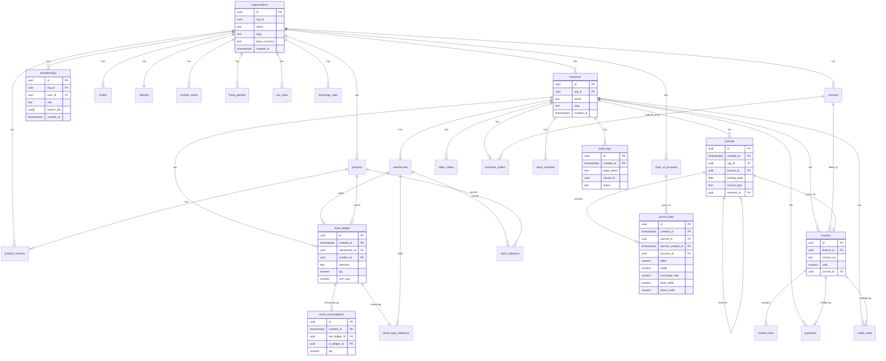

# ERP Core — Phase 1 (Backend)

The multi-tenant core that the Retail, Pharmacy, Hardware and School verticals will sit on. This
repository contains the backend only.

- Next.js 14 (App Router), TypeScript in strict mode
- Supabase (Postgres and Auth) with plain SQL migrations
- Vitest, running against a real local Postgres
- `pg` (node-postgres) for data access
- Money is `NUMERIC(19,4)` in Postgres and a `decimal.js` decimal in TypeScript

Prisma is deliberately not used. The schema lives in plain SQL migrations under
`supabase/migrations/`, because triggers, partitions, RLS and functions do not map onto Prisma
migrations, and Prisma usually connects as a role that bypasses RLS.

## Contents

- [Getting started](#getting-started)
- [Data model](#data-model)
- [Tenancy and RLS](#tenancy-and-rls)
- [Indexing strategy](#indexing-strategy)
- [Partitioning](#partitioning)
- [Accounting engine](#accounting-engine)
- [Inventory](#inventory)
- [Sales and purchases](#sales-and-purchases)
- [Retail extension (R1)](#retail-extension-r1)
- [Adding a vertical module](#adding-a-vertical-module)
- [Tests, checks and the perf run](#tests-checks-and-the-perf-run)

## Getting started

Docker must be running.

```bash
supabase start        # local Postgres and Auth
supabase db reset     # apply every migration to an empty database
cp .env.example .env.local   # if you do not have one yet
npm install
npm test              # the 40 tests, against the real local database
npm run build
```

`supabase status` prints the connection URLs. `DATABASE_URL` and `TEST_DATABASE_URL` both point at
the local database; no hosted Supabase project, Upstash or Redis is needed in this phase.

Business logic lives in SQL functions under the `app` schema. TypeScript route handlers in
`src/app/api/**` stay thin: they parse the request, call one function inside a user-scoped
transaction, and serialise the result. The domain modules in `src/core` and `src/accounting` are
typed wrappers over those functions.

## Data model



## Tenancy and RLS

Every tenant table has `org_id uuid NOT NULL` and `created_at timestamptz NOT NULL DEFAULT now()`.

- Org-scoped tables: `organizations` (its `id` is the `org_id`), `branches`, `memberships`,
  `invites`, `settings`, `number_series`, `products`, `product_variants`, `contacts`,
  `chart_of_accounts`, `tax_rates`, `exchange_rates`, `fiscal_periods`.
- Branch-scoped tables, which also carry `branch_id`: `warehouses`, `stock_ledger`,
  `stock_consumptions`, `stock_balances`, `stock_layer_balances`, `stock_transfers`, `journals`,
  `journal_lines`, `sales_orders`, `invoices`, `invoice_lines`, `payments`, `credit_notes`,
  `purchase_orders`, `audit_logs`.

RLS is enabled and forced on every tenant table. Policies read the JWT through `auth.jwt()`:

- Org-scoped policies compare `org_id` with `auth.jwt() ->> 'org_id'` (the key must be quoted).
- Branch-scoped policies also check `branch_id` against `auth.jwt() -> 'branch_ids'`.

A Supabase custom access token hook (`app.custom_access_token_hook`) adds `org_id` and
`branch_ids` to the token when it is minted.

> **Membership changes take effect when the token refreshes.** Policies read the claims baked into
> the current access token, never the `memberships` table. Adding or removing a membership does not
> change what an already-issued token can see. The user must refresh the token (sign in again, or
> wait for the refresh) before the change applies. Test 6 asserts exactly this.

Invites store only a SHA-256 hash of the token. A token is single use and expires after 72 hours.
The plaintext token is returned once, to the caller that created the invite, and never stored.

Application request paths run as the caller. `withUserContext` opens a transaction, runs
`SET LOCAL ROLE authenticated`, and sets `request.jwt.claims`, so RLS is genuinely enforced. The
service role key is never used on a request path.

Tests act as a user the same way: inside a transaction they set the role and the claims. No test
runs as the `postgres` superuser for an RLS assertion.

## Indexing strategy

- Branch-scoped high-volume tables get `(org_id, branch_id, created_at DESC, id DESC)`. That index
  serves both the RLS predicate and keyset pagination on `(created_at, id)`.
- Org-scoped tables get `(org_id, created_at DESC, id DESC)`.
- Business keys get composite uniques: `UNIQUE(org_id, slug)` on `branches`, `UNIQUE(org_id, sku)`
  on `products`, `UNIQUE(org_id, code)` on `chart_of_accounts`, and so on.
- Every foreign key column gets an index.

Two scripts prove the invariants hold:

```bash
psql "$DATABASE_URL" -f scripts/check-fk-indexes.sql      # zero rows
psql "$DATABASE_URL" -f scripts/check-tenant-tables.sql   # zero rows
```

`check-fk-indexes.sql` returns one row per foreign key with no index whose leading columns match
the FK columns in order. `check-tenant-tables.sql` returns one row per tenant table missing
`org_id`, `created_at`, or RLS enabled and forced.

## Partitioning

`journals`, `journal_lines`, `stock_ledger`, `stock_consumptions` and `audit_logs` are
RANGE-partitioned monthly on `created_at`.

- Primary keys include `created_at`, for example `(id, created_at)`.
- Child rows carry the parent's partition key (`journal_created_at`, `out_ledger_created_at`,
  `in_ledger_created_at`) so the composite foreign key works.
- Migrations create partitions for the current month and the next two.
- There are no default partitions.

`app.ensure_partitions(months_ahead)` creates any missing partition for the current month plus
`months_ahead` months. Run it ahead of time, for example from a scheduled job:

```sql
select app.ensure_partitions(2);
```

It is safe to run repeatedly: it only creates partitions that do not exist yet.

## Accounting engine

Tables: `chart_of_accounts`, `fiscal_periods`, `tax_rates`, `exchange_rates`, `journals`,
`journal_lines`.

Each journal line stores `debit`, `credit`, `currency`, `exchange_rate`, `base_debit` and
`base_credit`. A line has either a debit or a credit, never both, and never a negative value.

- **Balance check.** A `DEFERRABLE INITIALLY DEFERRED` constraint trigger on `journal_lines`
  verifies at commit that each journal has at least two lines and that `sum(base_debit)` equals
  `sum(base_credit)`. See `docs/ADR.md` (ADR-0001) for why the trigger sits on the partitioned
  parent.
- **Rounding.** Base amounts are rounded to four decimal places per line. Any residual difference
  posts to the rounding account named in `settings`, never dropped silently.
- **Immutability.** Triggers reject `UPDATE` and `DELETE` on `journals`, `journal_lines`,
  `stock_ledger`, `stock_consumptions` and `audit_logs`, and the privileges are revoked from
  `authenticated`. A correction is a reversing journal whose `reversal_of` points at the original.
- **Closed periods.** A journal dated inside a closed `fiscal_periods` row is rejected.
- **Rates.** Exchange rates and VAT rates are effective-dated. Each journal line and each invoice
  line stores the rate it used, so a later rate change never rewrites history. Posting reads rates
  from the database inside its own transaction.
- **Reports.** Trial balance, P&L and balance sheet query `journal_lines` directly with indexed
  date-range predicates. There are no materialized views or summary tables in this phase.

`app.post_journal` is the single posting entry point, and `app.reverse_journal` posts the mirror
image of an existing journal.

## Inventory

Tables: `products`, `product_variants`, `warehouses`, `stock_ledger` (append-only movements),
`stock_consumptions` (which inbound layer each outbound movement consumed, and how much),
`stock_balances` (a mutable cache of on-hand quantity and value) and `stock_layer_balances` (a
mutable cache of remaining quantity per inbound layer).

- **FIFO.** `app.consume_fifo` consumes the oldest layer first and records every consumption as a
  new `stock_consumptions` row. A layer row is only ever decremented, never rewritten.
- **Lock order.** `app.lock_stock_balances` locks `stock_balances` rows one key at a time in
  ascending `(warehouse_id, product_id, variant_id)` order, which is what keeps concurrent
  transactions from deadlocking.
- **Negative stock** is rejected by default. `warehouses.allow_negative_stock` opts a warehouse in.
- `stock_balances` and `stock_layer_balances` are the only mutable caches, and both can be rebuilt
  from the immutable `stock_ledger`.

## Sales and purchases

- `app.post_receipt` — inbound stock layer plus journal (Dr Inventory, Cr Accounts Payable).
- `app.create_invoice` — takes a gapless number, locks stock in sorted order, checks availability,
  consumes FIFO layers, inserts the invoice and its lines, and posts the journal (Dr AR, Cr Revenue,
  Cr VAT Output, Dr COGS, Cr Inventory). All or nothing.
- `app.allocate_payment` — applies a payment to an invoice. It cannot exceed the open balance, and
  posts Dr Bank, Cr AR.
- `app.create_credit_note` — reverses revenue, VAT and AR, returns stock at the original FIFO cost,
  and posts a reversing journal.
- `app.post_stock_adjustment` — as described under [Inventory](#inventory).

Invoice numbers are gapless. They come from a `number_series` row locked with `SELECT ... FOR
UPDATE` inside the invoice transaction, so a rollback does not consume a number. SKUs also come
from `number_series`, generated in SQL. Postgres sequences are not used for either.

List endpoints use keyset pagination on `(created_at, id)`. The default limit is 50 and the maximum
is 100; anything else is rejected. `OFFSET` is never used. Queries use explicit column lists, never
`SELECT *`, and batch child rows with `= ANY($1)`, so there are no N+1 queries.

A generic trigger writes `audit_logs` for `invoices`, `payments`, `journals`, `products` and
`stock_ledger` (receipts and adjustments). Nothing on a request path reads it.

## Retail extension (R1)

R1 is the first additive extension of the core. It adds the product, barcode and search surface a
till needs, without touching a core accounting path. See `docs/ADR.md` (ADR-0008, ADR-0009) and
`docs/CORE_INTERFACE.md`.

- **New tables.** `categories` (nested through `parent_id`, org-scoped) and `product_batches`
  (batch master: `batch_no`, `expiry_date`). Both use the standard RLS, index and check rules.
- **New columns.** `products` gains `category_id`, `unit` (the `product_unit` enum), `is_weighable`
  and a generated `name_search tsvector`. `product_variants` gains `size`, `color` and `barcode`.
  Every column is nullable or defaulted, so existing rows and core code are unaffected.
- **Barcodes** live on the variant and are unique within an org only when present, enforced by a
  partial unique index `product_variants (org_id, barcode) where barcode is not null`.
- **Weighable items** accept a decimal quantity (for example `0.750` kg); everything else accepts
  whole units only. `src/verticals/retail/quantity.ts` normalises a till quantity to `NUMERIC(19,4)`
  and rejects anything else.
- **Search.** `app.search_products(org_id, query, limit)` matches an exact barcode first, then a
  trigram name match, ordered by relevance and capped at 20 rows. It is backed by a single combined
  GIN index `products (org_id extensions.uuid_ops, name extensions.gin_trgm_ops)`, so the org
  predicate and the trigram predicate use one index. An empty query returns nothing: the till never
  loads the catalogue at startup.
- **Endpoint.** `GET /api/pos/search?q=` is a thin handler over `src/verticals/retail/products.ts`.
- **Client.** `src/verticals/retail/TillSearch.tsx` debounces input by 150 ms, so one request goes
  out after the cashier stops typing, and fetches nothing on mount.

To keep the name search an index scan, the SQL function is inlined: it carries no `set search_path`
clause (that clause blocks inlining) and its body is a parenthesised `UNION ALL` rather than a CTE
(a CTE is materialised, which hides the constant term from the planner). Every object is
schema-qualified, so inlining is safe.

## Adding a vertical module

A vertical (Retail, Pharmacy, Hardware, School) sits on top of the core. It never edits a core
table without an ADR.

1. Give the vertical its own folder, for example `src/verticals/pharmacy/` for TypeScript and
   `supabase/migrations/<timestamp>_pharmacy_*.sql` for its own tables.
2. Depend only on core functions: `app.post_journal`, `app.post_receipt`, `app.create_invoice`,
   `app.allocate_payment`, `app.create_credit_note`, `app.post_stock_adjustment`,
   `app.next_number`, `app.ensure_partitions`. Call them, do not reimplement them.
3. Scope every new table by `org_id` (and `branch_id` when it is branch-scoped), and apply the same
   RLS, index and partition rules as the core: `select app.apply_tenant_rls('public.your_table',
   'org')` or `'branch'`.
4. Register the table in `scripts/check-tenant-tables.sql` so the invariant checks cover it.
5. If the vertical needs a new column on a core table, write an ADR first and stop for review.

## Tests, checks and the perf run

```bash
npm test          # 40 tests against the real local database
npm run build     # production build
npm run lint      # ESLint, including the no-any rule for src/accounting
npm run test:perf # seed 1M journal lines, EXPLAIN ANALYZE, write docs/perf/
```

`npm test` runs the 40 tests in `tests/`. The database is never mocked. Tenancy tests act as a user
by setting the role and the JWT claims inside a transaction, never as the `postgres` superuser.

`npm run test:perf` seeds 1,000,000 journal lines with `generate_series` inside SQL, then runs
`EXPLAIN ANALYZE` on a one-month trial balance and on a full-range trial balance. The one-month
query must prune to a single partition and use an index; the full-range query may use a sequential
scan. Output is written to `docs/perf/`. The run records timings and does not fail on them.

`src/accounting/**` is checked by an ESLint override that sets
`@typescript-eslint/no-explicit-any` to `error`. `npm run lint` fails if `any` appears there.

### The 40 tests

| Range | Area | File |
| --- | --- | --- |
| 1–8 | Tenancy and RLS | `tests/tenancy.test.ts` |
| 9–14 | Schema and indexes | `tests/tenancy.test.ts` |
| 15–24 | Accounting | `tests/accounting.test.ts` |
| 25–31 | Inventory | `tests/inventory.test.ts` |
| 32–37 | Sales and purchases | `tests/sales.test.ts` |
| 38–40 | Concurrency | `tests/sales.test.ts` |

## Documentation

- `PROGRESS.md` — milestone status and the gate evidence for each milestone.
- `docs/ADR.md` — architecture decision records, including the open items.
- `docs/perf/` — perf run output.
